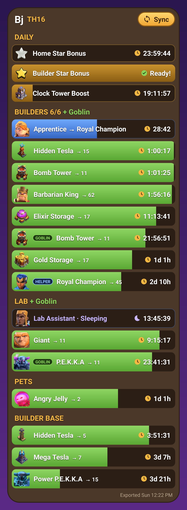

# Clash Timers

Android home-screen widget for Clash of Clans upgrade countdowns. It shows builders (plus the Goblin Builder), lab (plus the Goblin Researcher), heroes, pets and Builder Base. It also shows your Builder's Apprentice and Lab Assistant. Each row has the item's in-game artwork (buildings at the level they're upgrading to), a live countdown and a progress bar. The header shows your name, Town Hall level and a Sync button.



Supercell's public API doesn't expose upgrade timers, so the widget reads the game's own **Data Export** (Settings › More Settings › Data Export › Copy). That export is a snapshot: re-export whenever you start, finish or speed up something.

## Install (sideload)

1. On your phone (Android 8.0+), download the latest APK from [**Releases**](https://github.com/brutalpsychedic/clash-timers/releases/latest). Or build it yourself (see [Rebuilding](#rebuilding)) and copy it over. To update, install the newer APK over the old one; your settings stay.
2. Open it. Allow "Install unknown apps" for whichever app opened it. If Play Protect warns about an unknown developer, choose **Install anyway**.
3. Open **Clash Timers**, type your in-game name and tap **Save**. The export has your tag but not your name.
4. In Clash: **Settings › More Settings › Data Export › Copy**. Back in Clash Timers, tap **Sync from clipboard**.
5. Tap **Add widget to home screen**, or long-press the home screen › Widgets › Clash Timers. Resize it to taste; the list scrolls.
6. Android 14+: tap **Allow exact countdowns** when it appears. Without it, timers longer than a day show `2d 14h` instead of ticking `2d 14:08:52`.

## Daily use

- **Sync** on the widget reads the clipboard. If no new export is there, it opens Clash so you can copy one, then tap Sync again.
- Tapping any row opens Clash.
- **DAILY** (top of the widget): your once-a-day freebies for both villages. Each row's gold bar fills as the wait runs out, then turns to **Ready!**:
  - **Home Star Bonus** (24 h) and **Builder Star Bonus** (22 h): the export doesn't include these, so tap the row when you collect one and it counts down to the next.
  - **Clock Tower Boost**: synced from the export. It shows the free ×10 boost while it runs (26 min at level 7, i.e. 12 + 2 × level), then the wait until the next one. Builder Base timers speed up while it runs, and the Builder Base header gets a `×10` pill. Tap the row when you start the boost to log it without re-syncing.
  - Tapping a row that isn't ready opens the game. The app has buttons to log or reset these too.
- **Potions**: potions running when you export are read from the export automatically. If you drink one afterwards, log it in the app (Builder ×10, Research ×24, Pet ×24, 1 hour from now). The section header shows a `×10 34:44` pill while it runs.
- `💤 N builders idle`, `Laboratory idle` and `Pet House idle` rows appear when something isn't working.
- **Helpers**: the Apprentice sits at the top of Builders and the Lab Assistant at the top of Lab, each in a blue row:
  - `Apprentice → Royal Champion` with a countdown while it works its one-hour shift. The helped upgrade gets a blue **HELPER** tag and finishes sooner: the helper adds its level to the speed, e.g. a level 8 Apprentice makes it 9×, or 18× during a Builder Potion.
  - `Apprentice · Sleeping` with a moon and a countdown to the next work day once its shift is over.
  - `Apprentice · Ready to assign` (amber) once it's awake. With "Keep assigned" on, it shows `Apprentice → <upgrade>` marked `Awake` instead.
- The footer shows when the export was taken, plus `· N done` once upgrades finish (time to collect and re-sync).

## Icons and game data

Row icons are the game's own artwork, bundled in `app/src/main/assets/icons/`. Most items have one `<dataId>.webp`; buildings and traps have one per level, `<dataId>_<level>.webp`. Items with no artwork fall back to a coloured glyph. After a game update, refresh names, upgrade times and icons with:

```
powershell -ExecutionPolicy Bypass -File tools\update-assets.ps1
```

It needs a signed-in [GitHub CLI](https://cli.github.com/) (`gh auth login`) to list the icon files, then rebuild.

Icons and game data come from [ClashKing](https://github.com/ClashKingInc/ClashKingAssets) (`assets.clashk.ing`). Upgrade times come from the [coc-rush-helper](https://github.com/mateobaricevic/coc-rush-helper) snapshot of that data.

*This content is not affiliated with, endorsed, sponsored, or specifically approved by Supercell and Supercell is not responsible for it. For more information see [Supercell's Fan Content Policy](https://www.supercell.com/fan-content-policy).*

## Rebuilding

Open this folder in Android Studio and use Build › Build APK(s), or with JDK 17 and the Android SDK:

```
gradlew assembleRelease     # -> app/build/outputs/apk/release/app-release.apk
gradlew testReleaseUnitTest # parser/potion tests + renders app/build/preview/widget.png
```

Signing: if `keystore/clashtimers.jks` exists (it's git-ignored), builds are signed with it. A new APK then installs over the old one and keeps your settings. Without it, Gradle falls back to the Android debug key, and switching keys means uninstalling first. To make your own key:

```
keytool -genkeypair -keystore keystore/clashtimers.jks -alias clashtimers -keyalg RSA -keysize 2048 -validity 10000 -storepass clashtimers -keypass clashtimers -dname "CN=Clash Timers"
```

## Known limits

- **Upgrade durations** (for progress bars) come from a ClashKingAssets snapshot dated 2026-10-12. Anything added to the game later shows as `Item #id`, and its bar starts from the first sync. Run `tools/update-assets.ps1` to refresh it.
- **Potions and the Clock Tower** come from the export's `boosts` object (`builder_boost`, `lab_boost`, `pet_boost`, `clocktower_boost`, `clocktower_cooldown`), assuming upgrade timers there are un-boosted time left. The builder potion is also applied to the Goblin Builder. Builder Bite and Study Soup snacks (`*_consumable`) aren't modelled. Clock Tower Potions (always 30 min, no cooldown) aren't told apart from the free boost.
- **Star Bonus** timing is a rolling 24 h (home) / 22 h (Builder Base) from when you tap it, per community guides; Supercell doesn't publish it. A second stacked bonus isn't tracked.
- **Helpers**: only the shift running at export time is counted. With "Keep assigned", the next day's shift isn't predicted, so re-sync after it. The helper fields (`helper_timer`, `helper_recurrent`, `helper_cooldown`) were worked out by community trackers; Supercell hasn't documented them.
- **Town Hall weapon vs. Town Hall upgrade**: a running Town Hall timer counts as a weapon upgrade when the weapon is below level 5. Otherwise it counts as the Town Hall itself.
- **Supercharges** show as `→ ⚡N` with a bar measured from the first sync.
- Without exact-alarm permission, a countdown that hits zero can show a minus sign for a few minutes until Android lets the widget refresh.
